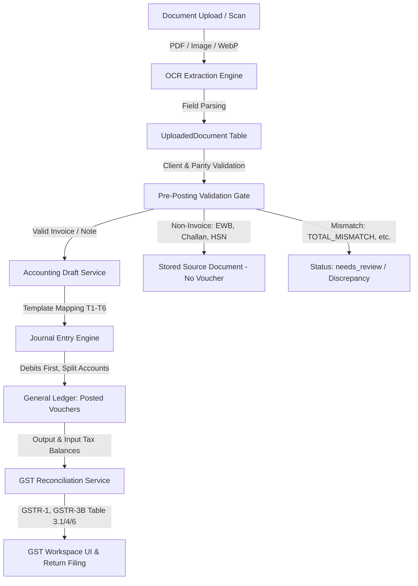

# FinLedger AI — GST & Accounting Pipeline Integrity Plan
**Branch**: `fix/gst-ledger-integrity`  
**Standard**: Statutory Double-Entry Bookkeeping & Indian GST Compliance (CGST Act, 2017)

---

## 1. End-to-End Real Flow Mapping

### Detailed Lifecycle Stages:
1. **Extract & Categorize**:
   - `backend/app/api/routers/ocr/router.py`: Layered OCR extraction parses native PDF/images into structured key-value fields.
   - Non-invoice parsers (`_parse_e_way_bill`, `_parse_challan`, `_parse_hsn_sac`) extract domain-specific fields (EWB No, Vehicle No, From/To, CPIN, CIN, HSN items).
   - Slips resolved: E-Way Bill vendor cannot be "Entered Date", S3 vendor cannot be "(From)", E-Invoice recipient must be "Kannan Software LLP".
2. **Pre-Posting Validation Gate**:
   - `backend/app/services/accounting_mapping_service.py` & `backend/app/services/document_validator.py`:
   - Checks: `TOTAL_MISMATCH` (variance > tolerance), `TAX_TYPE_MISMATCH` (intra with IGST, inter with CGST/SGST), `GSTIN_FORMAT_INVALID`, `DUPLICATE` (supplier GSTIN + doc no + type; e-invoice deduplication against invoice), `CLIENT_MISMATCH` (neither supplier nor recipient matches client GSTIN).
3. **Voucher Generation & Templates (T1 – T6)**:
   - `backend/app/services/accounting_mapping_service.py`:
     - T1 (Sales): Dr Debtors (counterparty) | Cr Sales | Cr Output Taxes.
     - T2 (Purchase): Dr Purchase/Expense | Dr Input Taxes | Cr Creditors (counterparty).
     - T3 (Sales Credit Note): Dr Sales Return | Dr Output Taxes | Cr Debtors (counterparty).
     - T4 (Sales Debit Note): Dr Debtors (counterparty) | Cr Other Sales/Income | Cr Output Taxes.
     - T5 (Purchase Debit Note): Dr Creditors (counterparty) | Cr Purchase Return | Cr Input Taxes.
     - T6 (Purchase Credit Note): Dr Creditors (counterparty) | Cr Purchase Return | Cr Input Taxes.
   - Note direction: Anchor is `client.gst_number`. Ambiguity resolved via linked invoice `Against Invoice X dt Y` -> hint -> `needs_review` with CA selection (`applies_to: sales | purchase`).
4. **Ledger Posting**:
   - `backend/app/services/journal_entry_service.py`:
     - All debits (`debit_amount > 0`) ordered first (`line_number = 1, 2, ...`), credits next.
     - Every posted voucher strictly references an existing `document_id`.
     - Deletion of document with posted entry is blocked; offer reversal/void.
5. **GST Module (Single Source of Truth = Posted Ledger Vouchers)**:
   - `backend/app/services/gst_reconciliation_service.py`:
     - Reads posted vouchers filtered by client and document date within period.
     - GSTR-1: B2B, B2C Large (> ₹1,00,000 inter-state unregistered per Notification 12/2024-CT), B2C Small (intra-state + inter-state <= ₹1,00,000), CDNR / CDNUR (sales-side notes only).
     - Inward Register (ITC): Only inward vouchers (T2, T5, T6).
     - GSTR-3B: Statutory set-off order (IGST -> IGST, CGST, SGST; CGST -> CGST, IGST; SGST -> SGST, IGST; CGST and SGST never cross-utilized). Cash payable per head floored at 0, carried forward credit tracked.
6. **UI Integration**:
   - `src/app/components/client/GstWorkspaceView.tsx`: Period selector (Quarterly/Monthly per client), B2C Large section, rename to "Purchase Register (ITC)", Sec 16(2) compliance indicator, pre-filled read-only return filing modal.
   - `src/app/components/client/VoucherDetailModal.tsx`: Rate % display, accounting group classifications ("Trade Payables", "Duties & Taxes (Asset)").

---

## 2. File-by-File Change Plan (C1 – C12)

| Change ID | Description | Files to Touch | Nature of Change |
|---|---|---|---|
| **C1** | GST Reads Ledger Only | `backend/app/services/gst_reconciliation_service.py`, `backend/app/schemas/gst_reconciliation.py` | Query posted `JournalEntryLine` accounts (2110/2120/2130, 1210/1220/1230) joined to document metadata. Exclude all unposted documents. |
| **C2** | GST Lines on Every Voucher (T1–T6) | `backend/app/services/accounting_mapping_service.py`, `backend/app/services/chart_of_accounts_service.py` | Implement T1 to T6 templates with individual GST head accounts (2110, 2120, 2130, 1210, 1220, 1230, 4030). Guarantee counterparty party account. |
| **C3** | Direction from Document Anchor | `backend/app/services/accounting_mapping_service.py`, `backend/app/services/gst_reconciliation_service.py`, `backend/app/models/uploaded_document.py` | Compare supplier & recipient GSTIN to `client.gst_number`. Match against original invoice for notes. Add additive column `applies_to` for CA review fallback. Reject client mismatch with `CLIENT_MISMATCH`. |
| **C4** | GSTR-1 Statutory Classification | `backend/app/services/gst_reconciliation_service.py`, `backend/app/core/config.py` | B2B (registered recipient), B2C Large (> ₹1,00,000 inter-state unregistered), B2C Small (intra + inter <= ₹1,00,000), CDNR/CDNUR (sales notes only). |
| **C5** | Inward Register & ITC Fixes | `backend/app/services/gst_reconciliation_service.py`, `src/app/components/client/GstWorkspaceView.tsx` | Include only inward vouchers (T2, T5, T6). Rename tab label to "Purchase Register (ITC)". Banner checks all documents before asserting Sec 16(2) compliance. |
| **C6** | Pre-Posting Validation Gate | `backend/app/services/accounting_mapping_service.py`, `backend/app/services/document_validator.py`, `backend/app/core/config.py` | Enforce error codes: `TOTAL_MISMATCH`, `TAX_TYPE_MISMATCH`, `GSTIN_FORMAT_INVALID`, `DUPLICATE`, `CLIENT_MISMATCH`. Document date sets period. Zero plug logic. |
| **C7** | Non-Invoice Documents & OCR Cleanups | `backend/app/api/routers/ocr/router.py`, `backend/app/services/accounting_draft_service.py` | Exclude E-Way Bill, GST Challan, HSN List from invoice tax math and vouchers. Extract EWB & Challan specific fields. Fix vendor "(From)" on S3, "Entered Date" on EWB, and customer "Kannan Software LLP" on E1. |
| **C8** | Data Integrity & Audit Protection | `backend/app/models/journal_entry.py`, `backend/app/services/journal_entry_service.py`, `backend/app/api/invoice_router.py`, `backend/scripts/integrity_check.py` | Enforce document existence on posted vouchers; block document deletion if linked to posted voucher (offer reversing void); add integrity report script. Non-invoice docs excluded from Posted counter. |
| **C9** | Period Control & Frequency | `backend/app/models/client.py`, `backend/app/services/gst_reconciliation_service.py`, `src/app/components/client/GstWorkspaceView.tsx` | Add `return_frequency` (Monthly/Quarterly) to client profile; add period selector in UI (default current quarter/month); filter GST figures by voucher date; statutory due date config table. |
| **C10** | GSTR-3B Statutory Set-Off | `backend/app/services/gst_reconciliation_service.py`, `backend/app/schemas/gst_reconciliation.py` | Statutory utilization order: IGST credit -> IGST, CGST, SGST liability. CGST credit -> CGST, IGST. SGST credit -> SGST, IGST. Split cash payable in Table 6. Track carried forward credit. Flag negative liabilities. |
| **C11** | Filing Record Integrity & Period Lock | `backend/app/api/routers/gst/router.py`, `backend/app/services/journal_entry_service.py` | Auto-populate filing figures from computed ledger for period (read-only). Reject duplicate filing for period+form. Lock period's posted vouchers upon filing. |
| **C12** | HSN Summary & UI Micro-Polish | `backend/app/services/gst_reconciliation_service.py`, `src/app/components/client/GstWorkspaceView.tsx`, `src/app/components/client/VoucherDetailModal.tsx` | Aggregate real posted outward lines for HSN summary Table 12; display tax rate % in voucher modal; label "Trade Payables" and "Duties & Taxes (Asset)". |

---

## 3. Existing Data Cleanup Plan (Section 7)
- Target: Client "Ankit public Ltd" (`27AABCF8939R1ZW`).
- Standalone script: `backend/scripts/cleanup_polluted_data.py`.
- Features:
  - Default `--dry-run`: lists orphan voucher `SV-2026-0001` (ref `NEG/0001`, no source document), voucher `PV-2026-0001` (ref `NEG/0002`), and bogus filing record `2026-09` GSTR-3B (taxable 7,00,00,000, tax 0).
  - With `--apply`: posts reversing mirror entries for the vouchers, and sets filing record status to `"voided"` to preserve audit trail without physical deletion.
